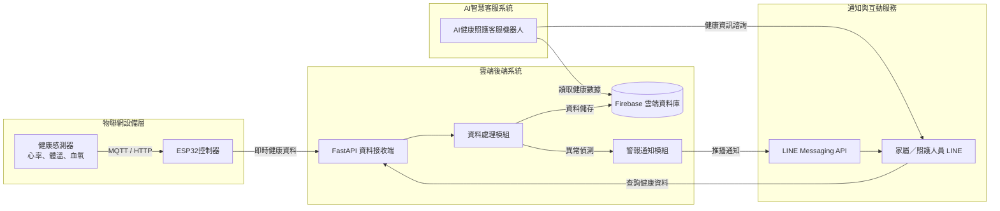

# 智慧長者確認與日常照護物聯網系統

## 專題目標 

為長者居家安全設計的**智慧照護物聯網系統**。我們著眼於「**讓長者保有自主性，照護者可以掌握必要資訊**」

系統採用**邊緣運算與本地優先（Local-First）**架構：長者端透過簡單的按鈕、OLED 顯示器與聲光提示獨立運作，即使網路中斷仍能保持提醒與紀錄；後端則透過 Python FastAPI 與 LINE Messaging API / Webhook，實現遠端即時異常推播、雙向參數修改與長期健康趨勢分析，達到遠端、即時、少干擾的照護目標。

> **IoT 核心 = 感知 $\times$ 判斷 $\times$ 連結 $\times$ 留存**

---

## 主要設計

- **長者端（簡單、自主、可離線）：**
  - **每日平安確認與認知測驗：** 定時蜂鳴器與 LED 提醒，結合符號記憶遊戲與按鈕計次回應，評估長者每日狀態。
  - **狀態精準區分：** 明確區分「未回應」（逾時未確認，不直接推論意外）與「量測失敗」（感測器接觸不良或無效），避免誤報。
  - **本地離線快取（Preferences / LittleFS）：** 斷網時數據自動暫存於 ESP32，連網後自動補傳，確保數據不丟失。

- **照護者端（遠端、即時、少干擾）：**
  - **LINE 即時異常推播：** A 階段提供主動通報（平安確認結果、未回應、生理數據異常）；B 階段提供 LINE Bot Webhook 雙向互動查詢。
  - **個人化用藥遠端設定：** 照護者可遠端經由後端 / LINE 調整長者用藥提醒時間、說明與重複規則。
  - **環境與生理監測：** 整合心率/血氧、室內溫濕度、光線明暗與指定區域距離變化。

---

## 三階段開發規劃

```ascii
[ A 階段：可運作原型 ] ──> [ B 階段：連網服務化 ] ──>       [ C 階段：進階管理 ]
 • ESP32 獨立運作           • Python FastAPI 後端          • 照護者 Web 管理介面
 • LINE 基本主動推播        • SQLite 資料庫架構             • 跨裝置資料同步
 • 本地顯示與快取儲存        • LINE Bot Webhook 雙向控制     • 長期趨勢與權限治理
```
## LINE Messaging API 服務模組深度解析

本專案的即時性仰賴於 LINE Messaging API 的精準調用與高效應對。我們將 LINE 通訊分解為三個核心機制：

### 1. 身份認證與憑證管理

- __機制：__ 應用程式透過 `CHANNEL_ACCESS_TOKEN` (發言權限) 進行 OAuth 認證，確保後端有權限替照護者發送訊息。
- __安全實踐：__ `CHANNEL_SECRET` (密碼) 僅用於後端驗證接收到的 Webhook 請求簽章 (Signature Verification)，防止第三方惡意發送假訊息。
- __實作點：__ 所有的 API 呼叫都必須依據 Token 進行 Header 授權。

### 2. 主動訊息推播

- __功能：__ 當 `LogProcessor` 偵測到異常時，`LineService` 觸發此功能。這是系統「發警報」的動作。
- __富媒體優勢：__ 採用 __Flex Message__ 格式，允許我們設計複雜、結構化的卡片 (Card)，而非單純的文字。Flex Message 可以包含圖示、按鈕和明確的警報層級標識 (CRITICAL/WARNING)，極大地提高了資訊的可視性和緊急性。
- __觸發時機：__ 僅在異常數據或平安確認逾時時觸發，避免系統濫發通知。

### 3. 雙向互動與 Webhook 接收

- __運作原理：__ 當照護者在 LINE App 上點擊警報卡片中的「確認收到」按鈕時，LINE 平台會將一個包含此互動事件的 JSON 訊息，透過 __Webhook__ 推送至我們的 FastAPI 服務 (`/api/line/webhook`)。
- __ID 獲取：__ Webhook Payload 中包含的事件資訊，正是我們獲取目標用戶 ID (`TARGET_LINE_USER_ID`) 的來源。
- __狀態流轉：__ 後端接收到此 Webhook 後，會執行業務邏輯，從警報狀態 `ALERT` 轉為 `ACKNOWLEDGED` (確認收到)，並更新資料庫紀錄。

---

## 系統架構圖

## 系統運作與數據流程 

__1. 感知與邊緣處置 (Edge Processing):__ ESP32 週期性讀取感測器數據，進行訊號去雜訊與狀態判定。

__2. 平安確認流程 (Daily Check-in):__ 在預定時間，ESP32 觸發提醒 $\rightarrow$ 長者操作按鈕與記憶遊戲 $\rightarrow$ 系統計算反應時間與答題結果。

__3. 狀態判定與資料傳輸:__

- __確認完成：__ 將數據封包準備上傳至後端。
- __未回應：__ 超過預設時間，標記為「未回應」（不直接判斷為意外事件）。
- __量測失敗：__ 獨立紀錄硬體異常，提示重測。
- __傳輸機制：__ 網路正常時，數據透過 Wi-Fi 送至 FastAPI；網路異常時，數據自動存入 ESP32 本地快取，復網後進行批量補傳。

__4. 遠端通知與儲存 (Cloud Processing):__ FastAPI 接收數據並寫入 SQLite。若判斷為異常事件，則即時呼叫 LINE Messaging API 推播給照護者。

---

## 硬體設備與接腳配置

### 設備與零件清單

| 項目 | 硬體設備 | 數量 | 負責功能 | 系統應用描述 |
| :---: | :--- | :---: | :--- | :--- |
| 1 | **NodeMCU-32S** | 1 | 系統主控 | 整合感測資料、控制各項功能與邊緣計算 |
| 2 | **蜂鳴器** | 1 | 聲音提醒 | 用藥提醒、異常警報與平安確認提示 |
| 3 | **DHT22** | 1 | 環境監測 | 量測室內溫度與濕度 |
| 4 | **光敏二極體模組** | 1 | 光線監測 | 判斷環境明暗與作息變化 |
| 5 | **HC-SR04** | 1 | 距離偵測 | 偵測指定區域（如床邊/門口）距離變化 |
| 6 | **OLED 顯示器** | 1 | 資訊顯示 | 顯示時間、感測數據、記憶遊戲與提示語 |
| 7 | **按鈕開關** | 1 | 使用者互動 | 平安確認、記憶遊戲回應及功能操作 |
| 8 | **MAX30100** | 1 | 生理數值量測 | 採集心率與血氧相關生理數據 |
| 9 | **杜邦線 (母對母)** | 20 | 訊號/電源連接 | 各模組接線 |
| 10 | **Grove 轉 4pin 杜邦線** | 1 | 轉接線 | 連接 MAX30100 感測器模組 |

### 接腳與 GPIO 對照表

| 項目 | 零件名稱 | 電源 VCC | 接地 GND | 主要 GPIO 連接 |
| :---: | :--- | :---: | :---: | :--- |
| 1 | DHT22 溫濕度感測器 | 3.3V | GND | `GPIO14` |
| 2 | HC-SR04 超音波模組 | 5V | GND | `GPIO16` (Trig) / `GPIO17` (Echo) |
| 3 | MAX30100 心率血氧儀 | 5V | GND | `GPIO21` (SDA) / `GPIO22` (SCL) |
| 4 | OLED 顯示器 (I2C) | 3.3V | GND | `GPIO21` (SDA) / `GPIO22` (SCL) |
| 5 | 蜂鳴器 (Buzzer) | 3.3V | GND | `GPIO18` |
| 6 | 按鈕開關 (Button) | 3.3V | GND | `GPIO19` |
| 7 | 光敏二極體模組 | 3.3V | GND | `GPIO25` |
| 8 | 提示 LED 燈 | 3.3V | GND | `GPIO27` |

---

### 技術/框架
| 類型 | 技術/框架 | 應用功能 |
| 硬體與韌體層 |	ESP32 (NodeMCU-32S), C++/Arduino IDE, LittleFS	系統主控核心，負責感測數據採集、邊緣運算與本地離線快取。 |
| 後端服務層 |	Python 3.10+, FastAPI, Uvicorn, Pydantic	高性能 Web API 核心，負責數據接收、路由與業務邏輯處理。 |
| 資料庫層 |	SQLite	輕量級持久化儲存感測器日誌、設備狀態與警報紀錄。 |
| 通訊協議 |	HTTP RESTful API, Wi-Fi, LINE Messaging API	負責 IoT 設備與雲端服務的數據交換，以及富媒體通知的發送與接收。 |
---

## 專案目錄結構 

```ascii

專題code
├── .env                      # 環境配置檔 (存放 API Keys 等敏感資訊)
├── HeartCare_TestSketch.ino  # 主程式 (ESP32) 入口文件，包含感測、排程、遊戲邏輯
├── SafetyCheckFSM.ino        # 有限狀態機文件，用於處理平安確認流程
├── StorageManager.ino        # 本地儲存管理文件，負責離線快取 (LittleFS)
├── README.md                 # 專題文件說明
├── smart_elderly_backend/    # 後端服務目錄 (FastAPI)
│   ├── app/
│   │   ├── main.py           # FastAPI 服務啟動入口
│   │   ├── database.py       # SQLite 連線與 ORM 設定
│   │   ├── log_processor.py  # 日誌處置、警報判定機制
│   │   ├── line_service.py   # LINE Bot API & Webhook 處理
│   │   └── endpoints/        # API 路由
│   │       ├── endpoints_ingest.py # 接收 ESP32 上傳數據
│   │       ├── endpoints_query.py  # 查詢生理/環境數據與警報紀錄
│   │       └── endpoints_config.py # 遠端用藥與提醒設定
│   ├── config/
│   │   └── settings.py       # 系統參數與 LINE Access Token 配置
│   └── requirements.txt      # Python 依賴庫列表
└── 健康照護機器人客服頭像.jpg # 專案圖示文件

```

---

## 系統運作與數據流程

1. **[感知與邊緣處置]** ESP32 週期性（$T$ 秒）讀取感測器數據，進行訊號去雜訊與狀態判定。
2. **[每日平安確認]** 到了預定時間，ESP32 觸發蜂鳴器/LED，OLED 顯示符號記憶遊戲，長者透過按鈕計次輸入。
3. **[狀態判定]**
   - **確認完成：** 計算反應時間與答題結果，封包準備上傳。
   - **未回應：** 超過預設時間未按壓按鈕，標示為「未回應」（非直接判定意外）。
   - **量測失敗：** MAX30100 接觸不良，提示重測並單獨紀錄。
4. **[傳輸與備份]**
   - 網路正常時：透過 Wi-Fi 送至 FastAPI 後端。
   - 網路異常時：自動寫入 ESP32 本地快取，復網後批量自動同步。
5. **[遠端通知與儲存]** FastAPI 接收數據寫入 SQLite，若為異常事件（如數據過高/未回應），即時呼叫 LINE Messaging API 推播給照護者。

---

## 安裝與執行教學

### 1. 後端 (FastAPI) 部署

```bash
# Clone 專案
git clone https://github.com/YOUR_USERNAME/YOUR_REPOSITORY.git
cd YOUR_REPOSITORY/backend_fastapi

# 安裝套件依賴
pip install -r requirements.txt

# 設定環境變數 (或修改 config/settings.py)
 ** LINE Token 配置指南：**
 1. CHANNEL_ACCESS_TOKEN: 
# 必須從 LINE Developers Console 的 Messaging API 設定中取得。
#    它用於您的 FastAPI 後端「發送訊息」給照護者。
 2. LINE_CHANNEL_SECRET: 
# 必須從 Messaging API 設定中取得。
#    它用於 FastAPI 後端「驗證」接收到的 Webhook 請求的真實性，是安全防護的關鍵。
# 設置後，確保它們被安全地載入至環境變數或 config/settings.py。


# 啟動 FastAPI 服務
uvicorn app.main:app --host 0.0.0.0 --port 8000 --reload
```

### 2. 韌體 (ESP32) 燒錄

1. 開啟 Arduino IDE，安裝 `NodeMCU-32S` 開發板支援套件。
2. 安裝必要庫：`Adafruit_DHT`, `MAX30100lib`, `Adafruit_SSD1306`, `ArduinoJson`。
3. 開啟 `firmware_esp32/HeartCare_Main.ino`。
4. 設定 Wi-Fi SSID、Password 及 FastAPI 伺服器 IP 位址。
5. 選擇正確的 COM Port 並進行編譯與上傳。

---

## 主要 API 說明 (API Documentation)

### 1. 上傳感測數據 (ESP32 $\rightarrow$ Backend)
- **Endpoint:** `POST /api/v1/ingest/sensor`
- **Payload:**
```json
{
  "device_id": "ESP32_01",
  "heart_rate": 78,
  "spo2": 98,
  "temperature": 26.5,
  "humidity": 60,
  "light_level": 450,
  "distance_cm": 120
}
```

### 2. 上傳平安確認與記憶測驗結果
- **Endpoint:** `POST /api/v1/ingest/safety_check`
- **用途:** 傳輸每日平安確認和記憶測驗的結果。

```json
{
  "device_id": "ESP32_01",
  "status": "PASSED",
  "response_time_ms": 3200,
  "test_score": 100
}
```

### 3. LINE Webhook 接收端點
- **Endpoint:** `POST /api/v1/line/webhook`
- **Description:** 接收 LINE 平台發送的 Message / Event，處理雙向查詢與指令解析。

---

## 🔑 環境設定與啟動指南 (Configuration Guide)

本專案的運作需要一系列手動輸入的敏感資訊和環境參數。請務必根據您的實際環境和業務需求，在以下位置安全地設定這些值。

### 🟢 I. LINE Messaging API 服務配置 (LINE Developers Console)
這些 Token 與 ID 必須從您的 LINE Developers Console 中取得，並安全地存放在 `.env` 文件或 `config/settings.py` 中。

*   **`CHANNEL_ID`**: 頻道的唯一識別碼。
*   **`CHANNEL_SECRET`**: 頻道密碼。用於後端驗證 Webhook 請求真實性（安全性關鍵）。
*   **`CHANNEL_ACCESS_TOKEN`**: 存取權杖。允許 FastAPI 後端向照護者發送訊息。
*   **`TARGET_USER_ID`**: **照護者/接收警報的目標用戶 ID**。這是系統推送警報的接收方。
*   **`WEBHOOK_URL`**: 您的 FastAPI 服務的完整 HTTPS 公網地址。用於填寫 LINE Webhook URL。

### 🔵 II. 後端服務 (FastAPI Backend) 配置
這些參數控制伺服器和資料庫的運作方式。

*   **`DATABASE_URL`**: 資料庫連線字串（例如：`sqlite:///./app.db`）。
*   **`FASTAPI_HOST`**: 服務啟動時使用的 IP 位址 (預設: `0.0.0.0`)。
*   **`FASTAPI_PORT`**: 服務運行的埠號 (預設: `8000`)。

### 🔴 III. 邊緣運算裝置 (ESP32 Firmware) 配置
這些參數需要在 `HeartCare_TestSketch.ino` (或相關配置檔) 中設定，以讓設備能與雲端連線。

*   **`DEVICE_ID`**: **每個感測器設備的唯一標識** (例如: `ESP32_RoomA`)。這用於後端追蹤數據來源。
*   **`WIFI_SSID` / `WIFI_PASSWORD`**: 設備連接 Wi-Fi 所需的網路名稱和密碼。
*   **`BACKEND_API_ADDRESS`**: ESP32 用來傳送數據給 FastAPI 伺服器的 IP 和埠號。

---
**💡 提醒：** 所有敏感資訊（Token, Secret, Password）都應使用 **環境變數 (.env 文件)** 進行管理，而非直接硬編碼在程式碼中。

