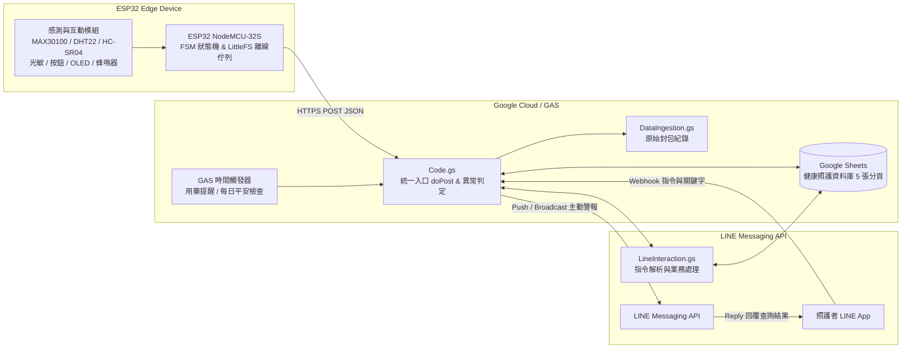

# 智慧長者平安確認與日常照護物聯網系統 (HeartCare IoT System)

## 專題目標

為長者居家安全設計的**智慧照護物聯網系統**，著眼於「**讓長者保有自主性，照護者能即時掌握必要資訊**」。

系統採用**邊緣運算與本地優先（Local-First）**架構：長者端透過單一實體按鈕、OLED 螢幕、超音波靠近偵測與蜂鳴器獨立運作，即使 Wi-Fi 斷線仍可進行離線紀錄並於復網後自動補傳；雲端則採用 **Google Apps Script (GAS)** 搭配 **Google Sheets** 作為輕量化無伺服器（Serverless）後端，結合 **LINE Messaging API** 實現即時異常推播、定時用藥提醒與雙向指令查詢。

> **IoT 核心 = 感知 × 判斷 × 連結 × 留存**

---

## 主要功能與設計特色

### 1. 長者端（ESP32：簡單操作、自主量測、支援離線）
* **圖案記憶認知測驗與單鍵操作：**
  * 短按按鈕啟動平安確認（蜂鳴器提示 → OLED 依序顯示 12 個隨機圖案 → 詢問指定圖案出現次數）。
  * 僅需單顆按鈕即可完成所有操作：**短按 `+1`**、**長按 2 秒確認送出**。
* **超音波自動偵測靠近 (`DETECTING_PRESENCE`)：**
  * 當 `HC-SR04` 偵測前方 `<= 50 cm` 有人停留 **3 秒**，自動進入心率/血氧量測（結束後具備 **30 秒冷卻期**，避免重複誤觸發）。
* **狀態精準區分與量測穩定保護：**
  * 明確區分「**測驗未通過 (`memory_quiz` FAIL)**」、「**超時未回應 (`no_response`)**」與「**感測器量測逾時/失敗 (`measurement_failed`)**」，避免誤判緊急意外。
  * 進入生理量測後強制等待 **3 秒穩定採樣期**，防止 `MAX30100` 誤讀前次暫存數值。
* **環境監測與定時上報：**
  * 週期性讀取 `DHT22` 溫濕度與光敏數值；若溫度超過 `35.0°C` 立即觸發蜂鳴器間歇鳴叫警示並上報 `temperature_alert`。
  * 待機時每 **60 秒** 自動上報一次 `periodic_status` 數據至雲端。
* **本地離線快取 (`LittleFS` / `Preferences`)：**
  * 斷網時事件自動存入 ESP32 `LittleFS` 離線佇列（`/pending_queue.json`，上限 15 筆），連網後自動補傳；單筆連續失敗 5 次自動略過，防止佇列卡死。

### 2. 照護者端（GAS + Google Sheets + LINE Bot）
* **LINE 即時異常警報與防洗版冷卻：**
  * 雲端自動判斷心率（`< 60` 或 `> 100 BPM`）、血氧（`< 95%` 偏低 / `< 90%` 危險）、環境高溫（`> 35°C`）、測驗失敗與未回應事件，透過 LINE Messaging API 主動推播給照護者。
  * 內建 **10 分鐘警報冷卻機制**（`canTriggerAlert`），且 `periodic_status` 僅紀錄不重複對舊心率/血氧發送警報，保護 LINE 免費推播額度。
* **定時用藥提醒與每日平安檢查：**
  * 透過 GAS 時間驅動觸發器，每分鐘比對 `MedicationSchedule` 到點自動發送用藥提醒；每日定時檢查長者是否已完成平安確認（`PASS`）。
* **LINE 雙向互動查詢與遠端用藥管理：**
  * 照護者可直接在 LINE 聊天室透過**斜線指令**或**中文關鍵字**查詢最新狀態、近 7 天心率血氧統計、新增/修改/停用藥品排程，以及記錄與查詢今日服藥狀態。

---

## 系統架構圖



---

## 專案目錄結構

```text
HeartCare/
├── HeartCare_ESP32.ino        # ESP32 主程式 (感測器、記憶測驗、靠近偵測 FSM、LittleFS、HTTPS 上傳)
├── gas/                       # Google Apps Script 專案程式 (請放於同一個 GAS 專案內)
│   ├── Code.gs                # 全域設定、唯一 doPost 入口、用藥管理、異常判斷與冷卻、定時觸發函式
│   ├── DataIngestion.gs       # 將原始封包與事件紀錄寫入 Device_Data 分頁
│   └── LineInteraction.gs     # LINE Webhook 處理、指令與關鍵字解析、查詢回覆
└── README.md                  # 專題說明文件
```

---

## 硬體設備與接腳配置

### 設備與零件清單

| 項目 | 硬體設備 | 數量 | 負責功能 | 系統應用描述 |
| :---: | :--- | :---: | :--- | :--- |
| 1 | **NodeMCU-32S (ESP32)** | 1 | 系統主控 | 整合感測資料、FSM 狀態機控制、記憶測驗與離線佇列 |
| 2 | **OLED 顯示器 (SSD1306 128×64)** | 1 | 資訊顯示 | 顯示系統狀態、溫濕度、心率血氧、記憶測驗圖案與提示 |
| 3 | **MAX30100 心率血氧模組** | 1 | 生理數值量測 | 採集心率 (BPM) 與血氧飽和度 (SpO2 %) |
| 4 | **DHT22 溫濕度感測器** | 1 | 環境監測 | 量測室內溫度 (°C) 與相對濕度 (%) |
| 5 | **HC-SR04 超音波模組** | 1 | 距離偵測 | 偵測使用者靠近（≤ 50 cm 持續 3 秒自動觸發量測） |
| 6 | **光敏感測器模組** | 1 | 光線監測 | 讀取環境亮度並用於亂數種子輔助 |
| 7 | **實體按鈕開關** | 1 | 使用者互動 | 短按啟動/計數 `+1`、長按 2 秒確認送出 |
| 8 | **蜂鳴器 (Buzzer)** | 1 | 聲音提醒 | 平安確認開始提示、高溫超過 35°C 間歇警報 |

### 實際接腳與 GPIO 對照表

> **設計亮點：** OLED 與 MAX30100 採用 **兩組獨立的 I2C 匯流排**（`OLED_Wire(1)` 與預設 `Wire`），避免共同掛載在同一條匯流排上產生位址或時序干擾。

| 零件名稱 | 電源 / 接地 | 訊號腳位 (ESP32 GPIO) | 備註 |
| :--- | :--- | :--- | :--- |
| **OLED 顯示器 (I2C #1)** | 3.3V / GND | `GPIO21` (SDA) / `GPIO22` (SCL) | `OLED_Wire(1)` @ 400kHz，位址 `0x3C` |
| **MAX30100 心率血氧 (I2C #2)** | 3.3V~5V / GND | `GPIO19` (SDA) / `GPIO18` (SCL) | 預設 `Wire` @ 100kHz |
| **DHT22 溫濕度感測器** | 3.3V / GND | `GPIO14` | 數位訊號腳 |
| **HC-SR04 超音波模組** | 5V / GND | `GPIO16` (Trig) / `GPIO17` (Echo) | 需接 5V 供電以確保測距穩定 |
| **光敏感測器** | 3.3V / GND | `GPIO34` | 類比輸入腳 (ADC) |
| **實體按鈕開關** | GND (另一端接 GPIO) | `GPIO27` | 程式啟用內部上拉 `INPUT_PULLUP`（按下為 LOW） |
| **蜂鳴器 (Buzzer)** | GND | `GPIO25` | 支援有源/無源切換（`PASSIVE_BUZZER` 開關） |

---

## Google Sheet 資料庫格式

試算表名稱：`健康照護資料庫(Healthcare Database)`  
底下需建立 **5 張純英文名稱**的工作表分頁：

1. **`SensorDataLog`**（感測器與測驗日誌）  
   `Timestamp` | `DeviceID` | `HR` | `SpO2` | `Temp` | `Humidity` | `Light` | `Distance` | `Quiz_Status` | `Quiz_Ans` | `Quiz_Exp` | `Battery` | `Event_Type`
2. **`MedicationSchedule`**（藥品排程配置）  
   `ID` | `DrugName` | `Dosage` | `ScheduleTime` | `Active`  
   *(提醒：`ScheduleTime` 欄位格式請設為「純文字」，例如 `08:00`)*
3. **`MedicationLog`**（每日服藥紀錄）  
   `Timestamp` | `Date` | `DrugID` | `DrugName` | `Status`  
   *(提醒：`Date` 欄位格式請設為「純文字」，例如 `2026-11-28`)*
4. **`AlertLog`**（警報事件日誌）  
   `Timestamp` | `DeviceID` | `Alert_Type` | `Message`
5. **`Device_Data`**（原始裝置封包日誌）  
   `Timestamp` | `Data_Type` | `Payload`

---

## LINE Bot 指令與關鍵字一覽

### 1. 斜線指令（支援雙引號含空白參數）
* **查詢最新健康數據：** `/check_status` 或 `/get_latest_data`
* **查詢歷史趨勢統計：** `/history_hr` 或 `/get_history 2026-11-20 2026-11-28`
* **查詢今日平安確認：** `/peace_check`
* **新增藥品排程：** `/add_drug "降血壓藥" "100mg" 08:00`
* **查看藥品清單：** `/list_drugs`
* **修改藥品排程：** `/modify_drug M001 "50mg" 08:30` *(不修改的欄位填 `-`)*
* **停用 / 刪除藥品：** `/stop_drug M001` 或 `/delete_drug M001`
* **記錄已服藥：** `/log_medication "降血壓藥"` 或 `/log_medication M001`
* **查詢今日服藥紀錄：** `/daily_intake` 或 `/today_meds`

### 2. 中文關鍵字快捷
直接於聊天室輸入以下詞彙即可觸發對應功能：
* `健康狀態` / `最新數據`
* `健康紀錄` / `歷史趨勢`
* `用藥清單` / `藥品列表`
* `用藥管理` / `新增藥品`
* `今日提醒` / `用藥排程` / `服藥紀錄`
* `平安確認` / `狀態`

---

## 系統運作與資料流程

1. **[環境感知與定時上報]** ESP32 每 2 秒更新一次溫濕度、光線與距離；溫度超過 `35.0°C` 立即響鈴並上報 `temperature_alert`；待機每 60 秒自動透過 `periodic_status` 同步數據至雲端。
2. **[雙模式啟動健康檢查]**
   * **手動按鈕模式：** 短按按鈕 → 響鈴提示 → OLED 記憶測驗 → 長按確認答案（上報 `memory_quiz`）→ 進入生理量測。
   * **自動靠近模式：** 超音波偵測前方 `≤ 50 cm` 持續 3 秒 → 自動進入生理量測（免手動按鍵）。
3. **[穩定採樣與狀態判定]**
   * 進入量測後等待 **3 秒穩定採樣期**，於 15 秒內取得有效心率/血氧即上報 `safety_check_completed` 或 `presence_vital_measured`。
   * 若測驗逾時未作答則上報 `no_response`；若感測器逾時未取得數值則獨立標記 `measurement_failed`。
4. **[斷網保護與補傳]** 網路異常時事件暫存於 LittleFS `/pending_queue.json`，恢復 Wi-Fi 後每 10 秒自動補傳一筆。
5. **[雲端分析與 LINE 通知]** GAS `Code.gs` 接收數據寫入 Google Sheets，若生理數據異常或測驗未通過，經 10 分鐘冷卻檢核後透過 LINE Messaging API 推播通知照護者。

---

## 安裝與部署指南

### 1. Google Sheets 與 Apps Script (GAS) 部署
1. 建立 Google Sheet 試算表，依上方格式建立 5 張純英文名稱的分頁。
2. 開啟 **擴充功能 > Apps Script**，建立三個檔案：`Code.gs`、`DataIngestion.gs`、`LineInteraction.gs`，分別貼入對應程式碼。
3. 在 `Code.gs` 填入：
   * `SHEET_ID`：Google 試算表網址中的 ID。
   * `LINE_CHANNEL_ACCESS_TOKEN`：從 LINE Developers Console 取得的存取權杖。
4. 點選右上角 **部署 > 新增部署**：
   * 類型選擇：**網頁應用程式**
   * 執行身分：**我**
   * 誰可以存取：**所有人**
   * 部署後取得 **Web App URL**。
5. 設定 GAS **觸發條件**（左側時鐘圖示）：
   * 新增觸發：`checkScheduledMedications` → 時間驅動 → 分鐘計時器 → **每分鐘**。
   * 新增觸發：`dailyCheckinMonitor` → 時間驅動 → 日計時器 → **晚上 9 點至 10 點**。

### 2. LINE Developers Console 設定
1. 登入 LINE Developers Console，進入您的 Messaging API Channel。
2. 在 **Messaging API** 分頁貼上 GAS 的 **Web App URL** 至 **Webhook URL**，點選 **Verify** 確認回傳成功，並開啟 **Use webhook**。
3. 加入機器人好友後，**先在 LINE 聊天室隨意傳送一則訊息**（例如 `健康狀態`），讓系統自動記住您的 `LINE_USER_ID` 供主動警報推播使用。

### 3. ESP32 韌體燒錄
1. 使用 Arduino IDE，安裝 ESP32 開發板支援（選擇 `NodeMCU-32S` 或 `ESP32 Dev Module`）。
2. 安裝必要程式庫：
   * `Adafruit GFX Library`
   * `Adafruit SSD1306`
   * `MAX30100lib` (`OXullo/Arduino-MAX30100`)
   * `DHT sensor library`
   * `ArduinoJson` (v6)
3. 開啟 `HeartCare_ESP32.ino`，修改第 30～38 行的設定：
   * `WIFI_SSID`、`WIFI_PASSWORD`：現場 Wi-Fi 名稱與密碼。
   * `GAS_URL`：步驟一部署取得的 GAS Web App URL。
   * `PASSIVE_BUZZER`：有源蜂鳴器設 `false`、無源蜂鳴器設 `true`。
4. 選擇正確的 COM Port 進行編譯與上傳燒錄。

---

## 技術棧總覽

| 層級 | 採用技術 / 工具 | 應用說明 |
| :--- | :--- | :--- |
| **硬體與韌體** | ESP32 (NodeMCU-32S), C++ / Arduino, LittleFS, Preferences | 感測數據採集、雙 I2C 控制、FSM 狀態機、斷網離線佇列 |
| **雲端後端** | Google Apps Script (GAS) | Serverless Webhook 接收、用藥排程邏輯、警報冷卻與定時觸發 |
| **資料庫** | Google Sheets (5 張工作表) | 感測數據、用藥排程、服藥紀錄、警報與原始封包持久化儲存 |
| **通訊與互動** | HTTPS RESTful JSON, Wi-Fi, LINE Messaging API | ESP32 上傳數據、LINE 異常主動推播與雙向指令互動 |
